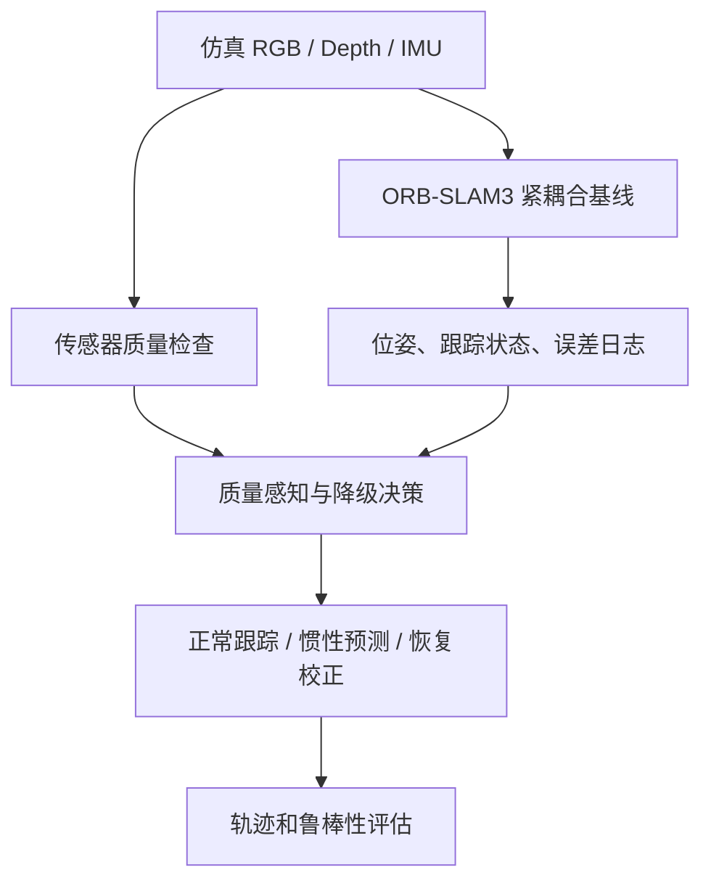

# 视觉–IMU–深度融合 6DoF 跟踪：五人课程项目技术方案与分工

> 英文标题：**ROBUST 6DOF TRACKING VIA VISUAL-INERTIAL-DEPTH FUSION**  
> 方案版本：v1.0｜2026-11-25｜定位：五人课程大作业，优先纯仿真、并行开发、可复现实验  
> 项目性质：**基于 ORB-SLAM3 的融合跟踪基线复现 + 传感器退化实验 + 质量感知与短时降级策略**。不以从零实现 SLAM、发论文或硬件部署为目标。

## 一、原课题要求：究竟需要完成什么

原课题围绕“视觉 + IMU + 深度/ToF”三种感知信息的 6DoF 位姿跟踪，提出三个问题：

1. **精度：**困难场景下，三传感器融合相较纯视觉、视觉+IMU，能否让绝对轨迹误差（ATE）降低至少 30%？
2. **鲁棒性：**弱纹理、快速运动、光照变化和动态遮挡条件下，能否将跟踪丢失率降低至少 50%？
3. **连续性：**视觉完全丢失时，能否依靠剩余传感器持续提供至少 2 秒**满足精度标准**的位姿预测，并在视觉恢复后重新定位？

原方案要求 ROS 融合包、公开数据集（EuRoC / TUM-VI）评测、自建挑战场景、分析脚本和报告。课程化实施保留**研究问题与量化验证逻辑**，调整实现范围：

| 项目 | 原方案 | 本课程方案 |
|---|---|---|
| 算法主体 | 自建 EKF 或因子图紧耦合融合 | 使用已支持 RGB-D + IMU 的 ORB-SLAM3，保留其现成紧耦合后端 |
| 自主改进 | 新增深度/ToF 约束和完整降级 | 实现数据质量评估、退化检测、辅助 IMU 预测及恢复策略 |
| 数据来源 | EuRoC / TUM-VI + 自采真实数据 | **TartanAir V2** 多模态仿真轨迹 + 可复现的故障注入；真实数据作选做 |
| 设备 | RealSense / Azure Kinect / ToF | **不采购硬件**，不模拟独立 ToF 物理成像 |
| 交付 | 完整 ROS 包和数据集 | GitHub 代码、复现实验配置、数据下载方法、日志、结果图、课程 PPT |

**必要边界：**EuRoC 和 TUM-VI 主要是视觉–惯性基准，不能在缺少原生深度观测的情况下公平验证 RGB+IMU+Depth 的额外收益；它们可以作为视觉惯性补充实验，而不是三模态核心基准。课程项目不用保证达到“30% / 50% / 2 秒”，需要把这些明确列为**待验证目标**。

## 二、项目故事线：未来 PPT 要讲清楚的完整研究逻辑

### 2.1 场景与问题：为什么需要这项研究？

相机跟踪物体特征以判断自身运动，IMU 在短时间内感知加速度和角速度，深度相机测量空间几何。它们可以互补：视觉长期约束位姿，IMU 提供高频短期预测，深度提供尺度与几何信息。但困难条件下仍存在观测缺失、噪声增强、漂移累积和跟踪丢失。

**PPT 核心问题句：**“多传感器都接进来了，系统是否就一定稳？当其中一个或多个传感器不可信时，如何知道何时降级，以及能够撑多久？”

可以用一张“三种传感器优点与弱点”图展示冲突：

- **RGB 像眼睛：**有纹理时定位较准，白墙、模糊、遮挡时可能失效。
- **IMU 像平衡感：**短时间不怕黑，但积分误差逐渐累积。
- **Depth 像尺子：**提供距离，但空洞、噪声和纯平面场景也会令约束退化。

### 2.2 已有工作与缺口：为什么不从零造轮子？

**ORB-SLAM3 已提供单目、视觉惯性、RGB-D 惯性等工作模式**，内部包含 ORB 特征、惯性预积分和优化，适合作为课程实验的统一平台。我们不宣称“发明三传感器紧耦合”，因为这部分是开源算法的已有能力。我们的工作聚焦于**故障发生前的质量评估、故障过程中的预测/降级，以及故障恢复的行为分析**。

要说明的现实限制：ORB-SLAM3 的 RGB-D 模式仍大量依赖图像特征。它不等同于“只要深度还在，就能在纯白墙上靠点云长期定位”。独立深度 ICP/点到平面配准是可选加分项，不纳入最低版本。

### 2.3 方法：我们提出什么方案？

整体方法命名可用：**Quality-Aware Degradation and Recovery（QADR）**；它是**课程项目内部方法名**，不是已有论文名称。



先实现**非侵入式策略层**：使用 ORB-SLAM3 的 RGB-D+IMU 输出、可取得的跟踪状态和传感器数据质量，对外发布“正常估计 / 短时惯性预测 / 不可信”状态与连续位姿。这样可以不用立即改优化器。未来有余力，再把观测质量转换为前端阈值或优化权重；**没修改优化权重就不能把这个工作称为新设计的动态加权紧耦合算法**，应称为“基于紧耦合基线的质量感知降级”。

策略状态（最简规则版）：

| 状态 | 触发指标示例 | 输出与动作 |
|---|---|---|
| NORMAL | 特征跟踪稳定且深度有效 | 沿用 ORB-SLAM3 输出，记录可信度 |
| VISION_DEGRADED | 内点数/内点率下降或跟踪状态异常 | 降低对当前视觉输出的信任，必要时使用短时 IMU 预测 |
| DEPTH_DEGRADED | 有效深度比例过低、深度缺失 | 使用剩余视觉惯性信息；在原生 RGB-D 模式下需验证缺深度帧能否稳定运行 |
| IMU_ONLY | RGB、深度均无法给出可用位姿 | 使用最近可信状态进行短时惯性积分，累计不确定度；超过时限标记不可信 |
| RECOVERY | 图像恢复且连续观测稳定 | 等待重定位和一致性检查，再切回正常输出；不把重新出现的第一帧直接判为成功 |

所有阈值先采用可解释规则、在训练/开发序列固定，再到测试序列检验，避免在测试集上不断调参。

### 2.4 预期创新点：实事求是地讲贡献

1. **可复现的多模态失效评测：**对 RGB、Depth、IMU 分别控制噪声、间断和退化时长，建立统一的试验条件与指标。
2. **质量感知的故障判断：**使用视觉匹配质量、深度有效率、IMU 预测不确定度等轻量指标，为何时降级提供可解释依据。
3. **短时预测与恢复输出：**在原 SLAM 跟踪中断时，增加带可信度标签的 IMU 连续预测，并客观测量可保持精度的时间。

**不是论文级算法创新：**主要贡献是成熟方法的组合、系统化实验和工程鲁棒性改进。若实验未改善 ATE，可报告“准确率与连续性存在权衡”，不能人为筛选成功段制造正向结果。

### 2.5 效果：PPT 最终要展示什么？

报告中展示真实实验值，而不是预填成功数字。准备如下四个主结果：

1. 正常场景的 **RGB / RGB+IMU / RGB-D+IMU** 三种轨迹覆盖图、ATE/RPE 柱状图。
2. 视觉退化程度从轻到重，**轨迹覆盖率和跟踪失效率**如何变化。
3. 深度无效比例、噪声强度增加时，**ATE 与可用帧比例**如何变化。
4. RGB+Depth 共同中断 0.5–3 秒时，**纯 IMU 预测误差–时间曲线**及完整 QADR 策略的恢复时间。

可作为挑战性总目标：相对 RGB+IMU，在选定困难场景下 ATE 下降 ≥30%、丢失率下降 ≥50%；视觉完全失效后 2 秒内仍达到预先设定误差标准。**这些不是验收保底数值**，最低验收是实验可重复、结论基于有效数据。

### 2.6 供直接排版的 10 页课程 PPT 结构

| 页 | 标题 | 要传达的一句话 | 素材归属 |
|---|---|---|---|
| 1 | 课题与目标 | Robust 6DoF Tracking via Visual-Inertial-Depth Fusion | 全组 |
| 2 | 问题背景 | 感知互补，但任何单传感器都有失效模式 | B/C/D |
| 3 | 已有方法与研究缺口 | ORB-SLAM3 会融合，但不等于恶劣场景永不丢失 | A |
| 4 | 本项目方法 | 在成熟紧耦合 SLAM 外加质量感知和降级恢复策略 | E/D |
| 5 | 仿真平台与评测设置 | 同一数据、同一故障、同一评测协议 | A/B/C |
| 6 | 融合基线结果 | 三模态在正常场景中提供怎样的精度与覆盖率 | A |
| 7 | 视觉与深度退化 | 两类退化下系统为什么会失败 | B/C |
| 8 | 视觉失效与 IMU 预测 | 2 秒预测误差到底有多大 | D |
| 9 | 降级策略消融 | 加策略前后的连续性、恢复时间是否改善 | E |
| 10 | 结论、局限与分工 | 哪些目标成立，哪些不成立，未来如何扩展 | 全组 |

## 三、统一实验协议：五个人只共享这一层

### 3.1 共同开源代码、数据、工具

| 资源 | 作用 | 官方或原始链接 |
|---|---|---|
| ORB-SLAM3 | 唯一的 SLAM 算法基线，包含 RGB-D-Inertial 示例 | https://github.com/UZ-SLAMLab/ORB_SLAM3 |
| ORB-SLAM3 RGB-D-Inertial 示例 | 对照接入方式与标定配置 | https://github.com/UZ-SLAMLab/ORB_SLAM3/blob/master/Examples/RGB-D-Inertial/rgbd_inertial_realsense_D435i.cc |
| ORB-SLAM3 System.h | `TrackRGBD`、位姿输出及跟踪状态接口 | https://github.com/UZ-SLAMLab/ORB_SLAM3/blob/master/include/System.h |
| TartanAir V2 | 共享 RGB、Depth、IMU、位姿真值 | https://tartanair.org/ |
| tartanairpy | 选择模态和轨迹、下载、数据读取 | https://github.com/castacks/tartanairpy |
| 数据格式说明 | 图像 10Hz、深度 float32 编码、标定、IMU 生成方式 | https://tartanair.org/modalities.html |
| evo | APE/ATE、RPE、轨迹可视化与结果汇总 | https://github.com/MichaelGrupp/evo |
| OpenLORIS-Scene（可选） | 不买设备的真实数据泛化验证 | https://lifelong-robotic-vision.github.io/dataset/scene.html |
| EuRoC（可选） | 原课题指定视觉惯性补充评测 | https://projects.asl.ethz.ch/datasets/euroc-mav/ |

**基线统一：**同一个 ORB-SLAM3 Git 提交、同一个编译环境、同一个标定文件和配置、同一条轨迹。五个人不各自找兼容性不明的 fork。记录 commit SHA 和软件版本。优先 Linux 本地离线运行；**ROS2 / Gazebo 都不是第一周必须项**。

**首批数据：**先选 TartanAir V2 同一场景的 1 条 easy、1 条 hard，均取前向相机 RGB+对齐 Depth+IMU+真值。**不预设具体轨迹 ID**，以下载器实际可用序列为准。后续增加不同场景测试泛化，防止只在一个场景上拟合阈值。

**数据关键事实：**TartanAir V2 常规 RGB 图像为 10Hz、640×640，深度虽可以按原始 float32 读出，下载时可能编码为四通道 PNG；IMU 由相机轨迹导数生成，官方提供噪声生成工具。故需核对编码、单位、时间戳、坐标系与惯性噪声。不能把 10Hz 图像改成 30Hz 直接宣称相机变快。高速运动与模糊实验需正确标注是“原始运动序列”还是“人工图像退化”。

### 3.2 所有成员遵循的输出接口

统一示例目录（不要求与 ORB-SLAM3 原源码完全相同）：

```text
project/
  docs/                 # 故事线、分工、PPT 素材清单
  configs/              # 统一场景、参数、相机标定、故障强度
  scripts/              # 格式转换、扰动生成、运行入口、评估
  experiments/
    A_baselines/
    B_visual_degradation/
    C_depth_degradation/
    D_inertial_outage/
    E_adaptive_recovery/
  results/
    A/ B/ C/ D/ E/      # 小尺寸 CSV、JSON、图；不存大体积原始数据
  reports/              # 汇报材料、实验说明、最终报告
```

共同文件规范：

- `manifest.csv`：帧时间戳、RGB 相对路径、深度相对路径、真值索引。
- `imu.csv`：时间戳、角速度 `(gx,gy,gz)`、线加速度 `(ax,ay,az)`，统一 SI 单位。
- `trajectory_est.tum`、`trajectory_gt.tum`：`timestamp tx ty tz qx qy qz qw`，明确世界/相机坐标定义。
- `tracking.csv`：`timestamp,valid,state,quality_rgb,quality_depth,source,latency_ms`，`source` 区分 SLAM 输出与 IMU 预测。
- `metrics.json`：数据集、序列、算法模式、配置版本、随机种子、ATE/RPE、有效位姿覆盖率、丢失段次数、恢复时间。
- `figures/*.png`：标题、坐标轴、单位和图例齐全的 PPT 可用图。

**统一评测原则：**

1. 数据扰动脚本生成确定性故障表（随机种子固定，如 0/1/2），让所有方法遭遇同一故障。
2. ATE/RPE 在**配对且有效的时间戳**上计算；同时报告有效轨迹覆盖率，避免“只跟踪少量容易片段，ATE 却很小”的误导。
3. RGB 单目存在尺度不确定性，评估时可按事先规定采用 Sim(3) 对齐；IMU/RGB-D 有真实尺度，应报告 SE(3) 对齐结果。两种对齐不能混为一谈。
4. 跟踪丢失的定义固定为“没有有效 SLAM 位姿输出或处于失跟状态”，连续失跟计作一个失效事件；辅助 IMU 输出必须单列，不得冒充视觉跟踪成功。
5. 恢复时间定义为从 RGB/Depth 恢复提供有效观测起，到连续若干帧（建议 ≥3 帧）可靠 SLAM 跟踪且误差在阈值内的时间；如果最后没恢复，记为未恢复，不能填 0。
6. 最少报告每个设置的 3 个种子，以及均值、标准差或中位数/分位数。只有 1 条轨迹时不得把数千帧视作独立重复实验。

### 3.3 统一验收门槛与挑战目标

| 指标 | 最低可交付验收 | 挑战性效果目标（不保证） |
|---|---|---|
| 基线运行 | easy/hard 各至少 1 条轨迹、3 个模式、可输出轨迹 | 扩至 ≥3 个场景，至少 3 次独立运行 |
| ATE/RPE | 正确对齐、可复算、有覆盖率 | 困难场景相对 RGB+IMU ATE 下降 ≥30% |
| 失跟率 | 失跟定义一致，完整故障强度曲线 | 相对 RGB+IMU 下降 ≥50% |
| 视觉中断预测 | 0.5、1、2、3 秒均有误差和失败记录 | 2 秒位置误差中位数 ≤0.5m、旋转 ≤5°；仅作激进目标 |
| 降级效果 | 有/无策略对照，能说明新增了什么 | 输出连续性、恢复时间显著改善，且无明显精度恶化 |

## 四、五个并行角色：A / B / C / D / E

以下所有目标中的数值均是**工作量与验收安排**，不是承诺实验一定会取得的性能指标。每人必须独立交付：`README`（问题、环境、运行命令）、源代码/配置、原始日志、评估 CSV/JSON、至少两张可用于 PPT 的图。

### A — 融合基线与定位精度：RGB、RGB+IMU、RGB-D+IMU

**独立研究问题：**增加 IMU 和 Depth 后，正常/困难序列中的定位精度、有效轨迹比例、计算耗时分别如何变化？

**资源：**[ORB-SLAM3 官方仓库](https://github.com/UZ-SLAMLab/ORB_SLAM3)、[System.h 追踪入口](https://github.com/UZ-SLAMLab/ORB_SLAM3/blob/master/include/System.h)、[D435i RGB-D+IMU 示例](https://github.com/UZ-SLAMLab/ORB_SLAM3/blob/master/Examples/RGB-D-Inertial/rgbd_inertial_realsense_D435i.cc)、[evo](https://github.com/MichaelGrupp/evo)。

**技术任务与代码：**

1. 在统一环境编译官方 ORB-SLAM3，确认 `MONOCULAR`、`IMU_MONOCULAR`、`IMU_RGBD` 三个模式能初始化。
2. 编写 `run_baselines`，把同一序列的 RGB/Depth/IMU 正确输入不同模式；确保时间戳、内参、深度单位、IMU 时间窗正确。
3. 导出所有时刻的有效位姿和跟踪状态；如原始接口不能直接提供日志，在程序入口层做最小改动，不碰优化器。
4. 使用 evo 计算 ATE/RPE，并统计跟踪覆盖率、每帧耗时。

**实验矩阵：**easy/hard × RGB、RGB+IMU、RGB-D+IMU；必要时补 RGB-D（无 IMU）作为深度消融；尽量重复 3 次。

**预计实验判断：**融合通常更利于恢复尺度、改善困难运动下的鲁棒性，但不预设“每条序列都更准”。

**验收目标：**至少 2 条轨迹 × 3 种模式均有可复算结果；每个模式至少 1 张轨迹图、一条 ATE/RPE 记录，明确初始化失败时怎样计入结果。

**交付物：**`experiments/A_baselines/` 运行脚本与说明、`results/A/baseline_metrics.csv`、轨迹叠加图（PNG）、ATE/RPE 对照柱状图、含 3 种模式的可讲解屏幕录制片段（选做）。

### B — 视觉退化鲁棒性：弱纹理、模糊、光照

**独立研究问题：**图像变差时，纯视觉和多传感器融合哪个先失效？是否能测出相对稳定的转折点？

**资源：**[TartanAir V2 RGB 模态/噪声说明](https://tartanair.org/modalities.html)、[tartanairpy 读取示例](https://github.com/castacks/tartanairpy/blob/main/docs/examples.rst)、[OpenCV 官方文档](https://docs.opencv.org/4.x/)。

**技术任务与代码：**

1. 编写离线 `visual_corrupt.py`，分别生成：高斯/方向性运动模糊、亮度变化、遮挡掩码、局部纹理抹除等图像版本。
2. 每种扰动设置 4 档强度；保存逐帧故障表和前后对比图。**弱纹理的局部抹除是图像级近似，不假装等同真实白墙几何。**
3. 在相同轨迹上测试 RGB-only 与 RGB+IMU，能复用 A 的统一入口即可；有余力再加入 RGB-D+IMU。
4. 统计有效帧比例、失跟事件次数、重新获得有效位姿的时间、ATE/RPE，并解释尺度对齐问题。

**实验矩阵：**至少 3 种退化 × 4 档强度 × 2 种算法 × 3 个随机种子，先用短轨迹控制运行时间。

**预计实验判断：**视觉质量变差后，纯视觉更早出现特征匹配失败；但 IMU 并不保证在极端模糊下仍可长期正常跟踪。

**验收目标：**生成 ≥12 个可重复故障配置、至少 2 张“强度—丢失率/覆盖率”曲线和一组“原图—故障图—特征跟踪”的说明图。

**交付物：**`experiments/B_visual_degradation/` 脚本、扰动参数 YAML、`results/B/visual_stress.csv`、视觉质量示例拼图、鲁棒性曲线、典型失败案例解读。

### C — 深度信息贡献及退化：噪声、缺失和空洞

**独立研究问题：**Depth 给融合系统增加了什么信息？Depth 逐渐失效，系统表现如何退化？

**资源：**[TartanAir V2 深度数据解码说明](https://tartanair.org/modalities.html)、[ORB-SLAM3 RGB-D 入口](https://github.com/UZ-SLAMLab/ORB_SLAM3/blob/master/include/System.h)、[TartanAir 下载工具](https://github.com/castacks/tartanairpy)。

**技术任务与代码：**

1. 编写 `depth_corrupt.py`，实现：随机无效像素 0/20/50/80%、深度测量高斯噪声、连续 0.5/1/2 秒整帧中断。
2. 对比 RGB+IMU 与 RGB-D+IMU；同时测试“深度被置为无效值而图像保留”的情况。
3. 验证官方 RGB-D+IMU 模式对于大量无效深度是否会正常运行、出现初始化失败还是轨迹重置；**不能假设它一定会无缝切换成单目惯性模式**。
4. 给出深度有效率与 ATE/覆盖率之间的关系。

**实验矩阵：**深度无效比例 4 档 × RGB-D+IMU；噪声至少 3 档；至少 2 条轨迹、固定 3 个种子。

**预计实验判断：**Depth 通常能够帮助尺度确定和近距 3D 特征约束，但效果依赖场景几何和有效深度数量；缺深度时可能退化甚至初始化失败。

**验收目标：**至少一张“无效深度比例—ATE/覆盖率”双指标图，一张“深度图原始—腐化”配图，报告与 RGB+IMU 的差异。

**交付物：**`experiments/C_depth_degradation/`、配置和脚本、`results/C/depth_ablation.csv`、深度可视化拼图、深度敏感性曲线和运行稳定性说明。

### D — IMU 单独预测：视觉双失效后的 2 秒问题

**独立研究问题：**一旦 RGB 与 Depth 都停止提供有效位姿，在不同 IMU 噪声和起始速度条件下，2 秒预测有多大误差？

**资源：**[TartanAir V2 IMU 生成和噪声模型](https://tartanair.org/modalities.html)、[Forster 等的 IMU 预积分论文](https://arxiv.org/abs/1512.02363)、[ORB-SLAM3 Frame 速度接口](https://github.com/UZ-SLAMLab/ORB_SLAM3/blob/master/include/Frame.h)。

**技术任务与代码：**

1. 独立用 Python/NumPy 编写 `imu_dead_reckoning.py`：给定失效起点的位姿、速度、IMU 偏置估计，在剩余 IMU 数据上积分，输出时序位置与姿态。
2. 在 0.5、1、2、3 秒时统计平移误差、角度误差的中位数与 90 分位数；注入不同陀螺仪/加速度计偏置与噪声。
3. 开发阶段可以先使用数据集真值作为**理想初始状态上界**；正式报告必须用基线 SLAM 最后可信估计状态作为初始化，并清楚区分理想上界与真实方案，**故障开始后绝不调用真值纠偏**。
4. 标注预测状态与协方差/可信程度变化，绘制典型 IMU 预测漂移轨迹。

**实验矩阵：**至少 3 种噪声强度 × 4 种中断时长 × ≥10 个不同起点；这些起点不应只选近似静止片段。

**预计实验判断：**预测随失效时长变差，陀螺偏置会影响方向，方向误差进一步放大位置误差。2 秒不是自然保证。

**验收目标：**完整输出 0.5/1/2/3 秒的误差表和置信曲线；工程挑战目标是 2 秒时位置误差中位数 ≤1m、旋转误差中位数 ≤10°，更严格的 ≤0.5m/≤5°仅作为理想目标，结果超出也应如实报告。

**交付物：**`experiments/D_inertial_outage/` 预测模块及测试、`results/D/outage_error.csv`、误差随时间曲线、轨迹漂移图、2 秒预测演示动画或 GIF（选做）。

### E — 质量感知降级与恢复：课程版核心改进

**独立研究问题：**能否用简单、可解释的质量指标，在错误位姿输出前检测风险，并在失效期间提供连续但诚实标注的不确定预测？

**资源：**[ORB-SLAM3 Tracking.h](https://github.com/UZ-SLAMLab/ORB_SLAM3/blob/master/include/Tracking.h)、[ORB-SLAM3 Tracking.cc](https://github.com/UZ-SLAMLab/ORB_SLAM3/blob/master/src/Tracking.cc)、[System.h 的 GetTrackingState](https://github.com/UZ-SLAMLab/ORB_SLAM3/blob/master/include/System.h)。

**技术任务与代码：**

1. 编写 `quality_monitor`：基于可获取的特征内点数/跟踪状态、深度有效率、连续帧稳定性形成 RGB 与 Depth 质量分数。遇到底层暂未暴露的指标，优先增加只读日志接口。
2. 编写 `degradation_policy`（NORMAL、VISION_DEGRADED、DEPTH_DEGRADED、IMU_ONLY、RECOVERY）；阈值、最短状态保持时间、连续恢复帧数全部配置化。
3. **并行开发方法：**先使用独立的、格式统一的 `tracking.csv` 模拟输入测试状态机；随后以 A 的真实日志替换输入。无需等待 B/C/D 的代码完成。
4. 对照：仅使用原始基线输出；加入质量监控但不补位姿；加入质量监控和 IMU 辅助预测。若 D 的模块尚未合并，可用同一接口的本地简化预测器完成实验。
5. 若时间允许，实现运行时实时接入 ORB-SLAM3。若仅完成离线轨迹重放策略，必须在汇报中清楚标为**离线策略验证**，不要称已实现实时系统闭环。

**实验矩阵：**至少 3 类故障 × 3 个策略消融 × 3 个种子，输出正常帧准确率、错误接管次数、预测覆盖时间、恢复时间。

**预计实验判断：**策略可能改善**输出连续性**与恢复效率，但 IMU 预测不是独立真值，不保证降低 ATE；如果预测太久，反而会引入显著误差。

**验收目标：**状态机测试覆盖 ≥5 个状态、至少 3 个切换边界；至少一张“状态时间轴”和一张“原始 / 质量监控 / 监控+预测”的结果对照图。

**交付物：**`experiments/E_adaptive_recovery/`、配置规则、状态日志 `results/E/policy_events.csv`、消融对照表、状态时间轴图、方法框架 PPT 素材。

## 五、协作方式：最低依赖、统一仓库、独立实验

### 5.1 合作原则：一个共享底座、五条并行实验支线

**开始时用一次集体技术对齐（约半天到一天）完成：**

1. 确定同一个 ORB-SLAM3 上游版本/commit，统一 Linux 环境或 Docker 镜像（不要求每人分别解决依赖冲突）。
2. 选定并下载至少一条 TartanAir V2 轨迹，核实 RGB/Depth/IMU/GT 四种数据齐全。
3. 固定相机内参、坐标系和输出 CSV/TUM 轨迹格式。
4. 写好一个最简数据读取示例、一个 `metrics.json` 示例、一个 `run_demo` 模板。

之后 B/C/D/E 在自己的实验数据/代码分支上独立推进；**A 对基础环境负责，但不能成为所有人必须等候的串行节点。**A 的预览运行结果可提前共享，其他人可直接使用同一基础启动程序，自行测试修改。

### 5.2 GitHub 仓库方案

**推荐方案：在组长的 GitHub 账号下 fork 官方 `UZ-SLAMLab/ORB_SLAM3`，所有人协作同一个 fork。**Fork 保留上游来源和 Git 历史；ORB-SLAM3 使用 GPLv3，修改和分发须保留原有许可证与归属。

正式 GitHub 账号和目标 URL 连接确认后确定。在此之前，只把以下当作仓库结构建议，不声称已创建 fork。

建议分支：

```text
master                         # 官方 fork 的默认分支，保存稳定集成版本
setup/common                   # 公共配置和数据接口（尽快合并 master）
experiment/a-baselines         # 成员 A
experiment/b-visual            # 成员 B
experiment/c-depth             # 成员 C
experiment/d-imu-prediction    # 成员 D
experiment/e-degradation       # 成员 E
```

规则：

- 每人只维护自己的 `experiments/<角色>/`、`results/<角色>/`，公共接口改动单独 PR；不要互相覆盖文件。
- `master` 不作为日常实验开发分支，统一用 PR 合并；PR 中必须说明输入、运行命令、输出路径、图表和已知问题。
- 一个模块跑不通不能阻止其他模块合并：可分别交付独立实验结果，最后集成属于加分项。
- 统一 `.gitignore` 忽略原始数据集、大型运行缓存、编译产物、虚拟环境、录屏等；大文件通过官方数据集下载脚本获取，不把数据集搬进 Git。
- 每组实验至少提交 `README.md`、代码/配置、`metrics.json`、至少两张 PPT 可用 PNG、一个失败案例说明。
- 公共结果由组长做最终整合，但研究内容和素材由每个人自己负责。

若 GitHub 连接完成，可由组长执行 GitHub Fork，再邀请另外四位为 Collaborators；个人 fork + PR 也是可行备选，但会增加同步成本，不作为首选。

### 5.3 最小接口保证并行，不强求五份代码完全拼成实时大系统

每位成员只需遵守**输入四样**：RGB、Depth、IMU、GT；**输出四样**：轨迹、状态日志、结果数值、PPT 图。E 的降级策略接收标准化状态日志，因此可以先离线实现，最后再接实时接口。

这是课程定位与工程系统定位的分界：

- **必须完成：**统一基线 + 5 个子实验 + 公平对照 + 脚本/数据/图 + 10 页左右故事完整的 PPT。
- **有余力完成：**所有模块合成单一运行程序、ROS2 包装、Gazebo 可控场景、实时可视化、额外深度 ICP 因子。
- **不要求：**重新实现 IMU 预积分、从零写图优化、购买独立 ToF、证明所设挑战性提升目标必然成立。

### 5.4 建议节奏与验收

| 时间 | 同步动作 | 各自并行进度 |
|---|---|---|
| 第 1 周 | 仓库、公共环境、选轨迹、格式冻结 | A 跑基线；B/C 写扰动脚本；D 写积分器；E 写状态机模拟 |
| 第 2 周 | 统一提交一份最小正常运行日志 | A 多模式运行；B/C 各完成第一轮故障实验；D 0.5–3 秒预测；E 策略单元测试 |
| 第 3 周 | 固定测试集与指标口径 | 各自跑完整参数矩阵，导出图表与失败案例 |
| 第 4 周 | PR 合并、结果校对、PPT 排版与彩排 | A–E 各出 1–2 页素材并讲解自己实验 |

如果实际只有 2 周，应删减种子/强度数量和 Gazebo，优先保留每人一条代表性实验曲线；绝不能缩减到“只有 PPT、没有结果”。

## 六、实验报告与汇报的证据规范

1. **图中标注真实实验信息：**数据集/序列、方法、退化类型、单位、是否对齐、随机种子。不要以概念示意图冒充结果图。
2. **不制造成功故事：**如果三模态在某序列不比视觉惯性强，应展示并解释可能原因（场景结构、初始化、深度退化、参数、运行时间），结果同样有意义。
3. **区分“跟踪恢复”与“预测连续”：**IMU 即使持续输出位置，也不代表 SLAM 跟踪成功。两个指标分别统计。
4. **失效时不能使用真值：**GT 只可用于数据准备的上界对照和结果评估，不可在测试期被算法读取并纠正估计。
5. **保留计算代价：**至少统计平均处理耗时或帧率，避免某方案准确但实际完全无法运行却被称作实时。
6. **复现命令与版本固定：**每张主结果图能追溯到配置、原始结果 CSV/JSON 和对应 Git commit。

## 七、官方参考资源与核心文献

### 工具与数据

- ORB-SLAM3 官方仓库及安装说明：https://github.com/UZ-SLAMLab/ORB_SLAM3
- RGB-D+IMU 官方入口示例：https://github.com/UZ-SLAMLab/ORB_SLAM3/blob/master/Examples/RGB-D-Inertial/rgbd_inertial_realsense_D435i.cc
- 跟踪/位姿输入接口：https://github.com/UZ-SLAMLab/ORB_SLAM3/blob/master/include/System.h
- TartanAir V2：https://tartanair.org/
- TartanAir V2 模态与 IMU 噪声说明：https://tartanair.org/modalities.html
- tartanairpy 工具与示例：https://github.com/castacks/tartanairpy
- evo 评估工具：https://github.com/MichaelGrupp/evo
- EuRoC MAV 官方网站：https://projects.asl.ethz.ch/datasets/euroc-mav/
- OpenLORIS-Scene 官方网站：https://lifelong-robotic-vision.github.io/dataset/scene.html
- Gazebo Harmonic（选做）：https://gazebosim.org/docs/harmonic/

### 阅读顺序

1. **Campos et al., ORB-SLAM3**, *IEEE T-RO*, 2021：了解原算法做了什么，避免把开源已有部分当创新。
2. **Forster et al., On-Manifold Preintegration**, *IEEE T-RO*, 2017：D 了解 IMU 积分为什么漂移，A/E 了解惯性状态。
3. **Burri et al., EuRoC MAV Datasets**, *IJRR*, 2016：了解视觉惯性跟踪 benchmark 的评价方式。
4. **Schubert et al., The TUM VI Benchmark**, *IROS*, 2018：了解真实高速运动、视觉惯性与真值评估。

## 八、项目最终交付检查清单

- [ ] 统一 fork 的仓库、上游来源与许可证归属清楚
- [ ] 公共数据下载说明与可复现运行环境
- [ ] A：三种融合基线与轨迹/ATE/RPE 对照
- [ ] B：至少三类视觉退化和鲁棒性曲线
- [ ] C：深度退化敏感性实验和深度消融
- [ ] D：IMU 0.5/1/2/3 秒预测误差与 2 秒结论
- [ ] E：质量评估、降级状态机和消融对照
- [ ] 每个结果可追溯至代码、配置、日志与随机种子
- [ ] 统一实验结果表、失败案例、局限性说明
- [ ] 10 页左右完整故事线 PPT、每位成员可独立讲述本人工作

**一句话概括最终故事：**我们以现有 RGB-D 惯性紧耦合算法为基础，系统测量不同传感器退化如何影响 6DoF 跟踪，并用轻量、可解释的质量感知与惯性短时降级策略尝试提高困难场景下的位姿输出连续性；全部结论由统一多模态仿真实验和可重复的对照实验支持。
